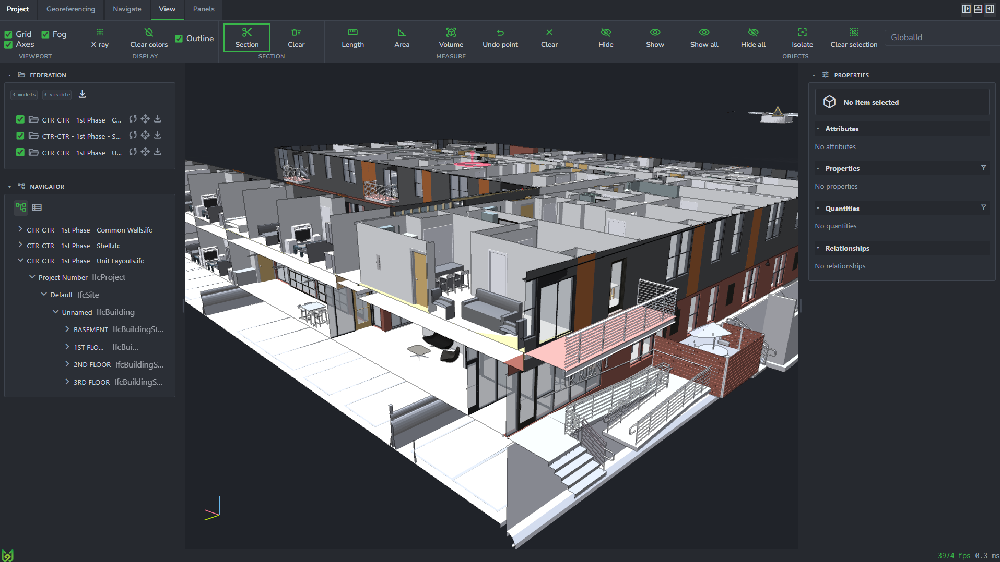

<p align="center">
  
</p>

<h1 align="center">Bonsai Web</h1>

<p align="center">
  IFC models, open in the browser.<br>
  Federation, spatial tree, properties, sections, and measure — one dark workspace.
</p>

<p align="center">
  <a href="https://myoualid.github.io/bonsai-web/"><strong>Open the app</strong></a>
</p>

<p align="center">
  <a href="https://myoualid.github.io/bonsai-web/">
    
  </a>
</p>

This repository is the site. [`index.html`](index.html) loads [`@aeco-dev/bonsaiweb`](https://www.npmjs.com/package/@aeco-dev/bonsaiweb) and IfcOpenShell in the browser. Ribbon, modules, layout, and geometry defaults live in [`configuration/`](configuration/).

## Workspace

The ribbon swaps with the work mode.

| Mode | What it holds |
| --- | --- |
| **Project** | New model, open an IFC, load the sample [`window_wall.ifc`](files/ifc/window_wall.ifc), save, clear, settings |
| **Georeferencing** | Survey point |
| **Navigate** | Standard views, frame model or selection, ortho, fly, and Blender, Rhino, Revit, or web camera presets |
| **View** | Grid, axes, fog, x-ray, section planes, length / area / volume, show, hide, isolate |
| **Panels** | Side panels and the profiler |

Boot modules: project, settings, georeferencing, spatial hierarchy, properties, viewer, profiling.

## Run locally

Static files. From this directory:

```bash
python -m http.server 8080
```

Then open [http://localhost:8080/](http://localhost:8080/).

[`index.html`](index.html) is the full workspace. [`headless.html`](headless.html) starts the same configuration without the default shell and leaves the app on `window.bonsai`.

## Configuration

| File | Role |
| --- | --- |
| [`configuration/config.js`](configuration/config.js) | Configuration passed to `start()` |
| [`configuration/config.modules.js`](configuration/config.modules.js) | Modules activated at boot |
| [`configuration/config.ribbon.js`](configuration/config.ribbon.js) | Work modes and ribbon commands |
| [`configuration/config.geometry.js`](configuration/config.geometry.js) | IFC kernel, threading, and delivery |
| [`configuration/config.ui.js`](configuration/config.ui.js) | Workspace layout |
| [`configuration/config.paths.js`](configuration/config.paths.js) | CDN paths for the viewer and compression libraries |

Geometry defaults use the manifold kernel and stream tessellation from a worker. Load operators take the same keys as a one-off override.

## Stack

From the import map, via jsDelivr: `@aeco-dev/bonsaiweb`, `@aeco-dev/gui`, `@aeco-dev/layout`, `ifcopenshell`, `@ifcopenshell/wasm`.

GitHub Pages serves the repository at `/bonsai-web/`. Paths in the pages are relative, so the same files work locally and on that project site.
